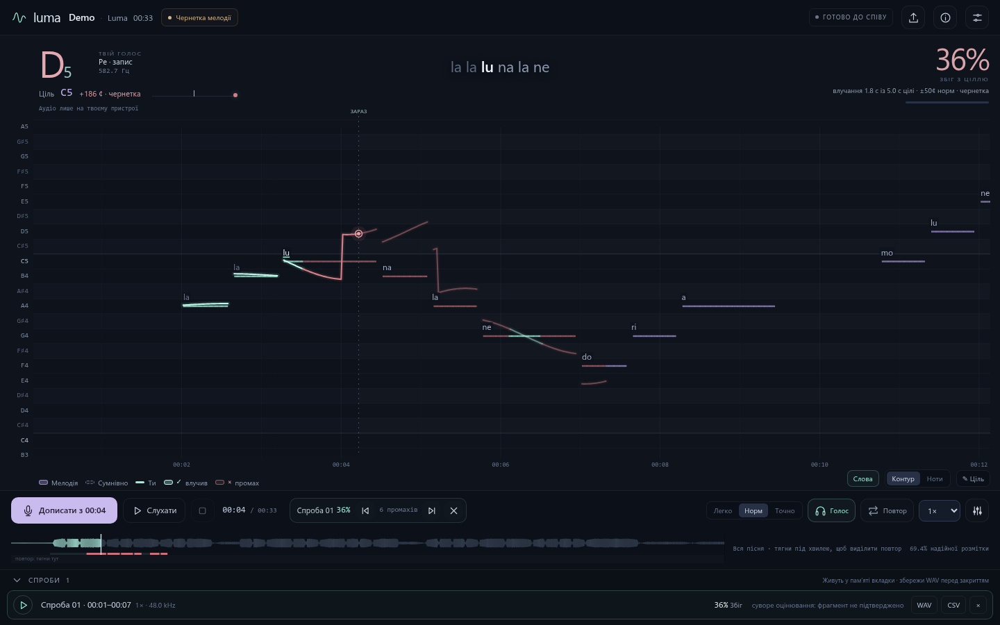
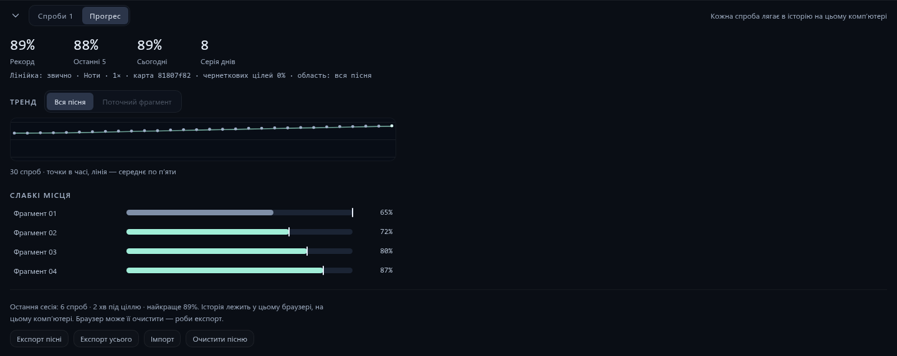

# Luma — sing along with the melody, see every note

Luma turns a song into a single HTML file where you sing over the backing track and watch your pitch against the melody
in real time. Drop a song into **Luma Studio**, wait a few minutes, open the trainer in a browser. No accounts, no uploads
of your voice, no server after the file is built.



## What the trainer does

- **Melody on a piano roll.** A trainer opens on the notes view — named bars a beginner can read — with the contour view a
  click away. Named C lines on a lit stage. Words sit right above the melody at the moment they are sung, and the current
  and next line ride in a band of their own; on a phone that band is a full row, so nothing ever covers the readout.
- **Live match score.** Hits ÷ frames with a target, counted once per 20 ms. Silence under a note is a miss; frames with no
  target are excluded; draft notes count and are labelled as draft. In a song with lyrics, notes that come nowhere near
  a word (stem bleed in a break, wordless singing) are drawn dimmed and never scored: «Без слів — не рахується». Hit notes turn mint with ✓, misses hatched red with ×,
  so the two differ in pattern as well as colour.
- **Three levels.** Легко (±80 ¢, octave errors forgiven), Звично (±50 ¢), Точно (±35 ¢); each also sets timing slack and how
  much of a note must be hit. Details in [docs/SCORING.md](docs/SCORING.md).
- **Fragment pitch scale.** The vertical range frames the notes in view plus the next four seconds, so it is already right when a phrase arrives. It grows only when upcoming notes would leave the margin, shrinks after two quiet seconds, and every change eases over a second. Confident voice enters through a percentile band, so a single glitch never moves the plot. Масштаб → Детальніше halves the minimum span.
- **Attempts are traces, not recordings.** Recording your voice into a WAV is a switch in the settings, off by default.
  Sing and the attempt stays on screen with its trace, its score and its per-frame results either way. Scrub back to see
  where you drifted, jump between misses, play the attempt back in sync with the backing, export CSV or JSON. Turn the
  switch on and your voice is recorded again: review with your own singing and WAV export come back with it.
- **Progress that lives on this computer.** Every finished attempt goes into a local history by itself — no files to save.
  The Прогрес tab shows the record, the average of the last five attempts, the best of the day, the day streak, a trend
  over attempts and the weak phrases — each bar is that phrase's personal best, with a notch where the last attempt
  landed, and a click on a phrase loops it. Behind the melody, your last 20 attempts at the song lie as faint dust,
  one speck per sung moment, so you see roughly where your voice usually goes without it getting in the way
  ([docs/design/TAKE_CLOUD.md](docs/design/TAKE_CLOUD.md)). Scores are only ever compared within the same level, target map, view and speed; see
  [docs/SCORING.md](docs/SCORING.md) and [docs/HISTORY_SCHEMA.md](docs/HISTORY_SCHEMA.md). Export and import are two
  buttons in the tab's footer.

  
- **Microphone offset from your attempts.** «Розрахувати затримку» in the settings compares the newest 30 usable
  attempts of every song with the melody and suggests the offset, with its precision and dates; one tap applies it.
  When the setting is clearly off, a hint after an attempt says so, at most once a day.
  [docs/design/LATENCY_AUTOCAL.md](docs/design/LATENCY_AUTOCAL.md)
- **Punch-in.** Seek inside an attempt and "Співати" becomes "Перезаписати з …": the same take is re-recorded from that point. Нова спроба records a separate take; Скасувати перезапис restores the previous version of the last punch.
- **Lives mode.** An optional switch in the settings, off by default: hearts in the corner of the stage, a life lost only to
  sustained misses under the notes (never to one short slip or to silence between phrases) burns in a short flash of
  fire ([docs/design/LIFE_BURN.md](docs/design/LIFE_BURN.md)), and when the last one goes
  the attempt is saved, the song rewinds to the start of the phrase and you sing it again after the count-in. Rules and
  constants in [docs/SCORING.md](docs/SCORING.md#lives-mode-режим-життів).
- **Відео з камерою.** «Знімати мене на камеру» in the settings, off by default, works in a trainer opened from Studio.
  With it on, the camera opens together with the microphone and «● ВІДЕО» shows in the top bar while it films. One video
  covers a sitting: from «Співати» until an attempt ends with no lives rewind after it, rewinds included. Studio turns
  every sitting of 30 s or longer into a 1920×1080 video. The game fills the frame (target notes, your live line, the dust of
  past takes, the words, the hearts with the same burn as on screen, the match %), with no buttons. The hearts, the % and
  you in a circle stand in one column on the part of the roll already sung; the roll fades out around them, so no note,
  word or line runs under the circle, the hearts or the %. The sound is your voice, shifted by the microphone offset,
  over the song's own instrumental. The attempt's card gets «Відео», which opens it in Studio. A camera that is refused, missing, busy or
  unplugged mid-take never stops the singing: the attempt goes on without video and the settings say why. While the
  camera is on, «Перезаписати з …» is off. Each A–B repeat pass is its own attempt and so its own video: a loop shorter
  than 30 s gives no video. Design in [docs/design/CAMERA_VIDEO_BUILD_BRIEF.md](docs/design/CAMERA_VIDEO_BUILD_BRIEF.md).
- **Built-in lessons.** Three warm-ups with exact synthetic targets; progress on them is kept per exercise, with one lamp
  per difficulty level, because one exercise is one skill sung through nine keys.
- **Loop and seek.** Whole song by default, and a sung pass of it stops half a second after the last scored note or lyric line
  (listening still plays the outro); draw an A–B region under the waveform or press A / B while listening, loop it
  without gaps. Seek during playback and the music picks up from there.
- **Vocal on/off.** One button (V) mutes the original vocal stem so you hear only the backing and yourself.
- Two speeds (1× and 0.8× with pitch preserved), vocal octave shift, mix balance, note editor, fragment verification.
- **VR with the room in view.** In a headset's browser (Quest Browser) the header shows **VR**: the trainer becomes one
  panel in Luma's own look, 1.5 m in front of the eyes over the passthrough. See «In a VR headset» below.
- Ukrainian interface. Works offline once built; needs `http://localhost` for the microphone (browsers refuse the audio
  worklet on `file://`).

## Luma Studio: from audio file to trainer

```sh
git clone https://github.com/Latand/luma && cd luma
studio/luma-studio.sh          # creates .venv, installs deps, starts http://127.0.0.1:8792 and opens it
```

Drop an `m4a` / `mp3` / `flac` / `wav` of up to 40 minutes, confirm title and artist (a file named `Song - Artist.m4a` fills them in), press
**Підготувати**. The pipeline (see [docs/PIPELINE.md](docs/PIPELINE.md)):

1. FFmpeg decode
2. official Demucs `htdemucs_ft` vocal separation (weights download once, ~320 MB)
3. pYIN + CREPE pitch on the vocal stem, fused into a note map with a strict reliability mask
4. MP3 stems at 1× and 0.8×
5. optional word timings through the Soniox API (set `SONIOX_API_KEY` or write the key to `~/.config/luma/soniox-api-key`;
   without a key lyrics are skipped)
6. one self-contained HTML in `songs/`

The library on the Studio page serves the trainers over http, so the microphone works out of the box. Додати готовий тренажер imports an existing Luma HTML, preserves its song data, and wraps it in the current app. Imported files get unique names so existing songs are preserved.
Command line equivalent: `.venv/bin/python studio/prepare_song.py song.m4a --title "Song" --artist "Artist"`.

**Album covers.** Each library tile shows the album picture embedded in the song's audio file. `studio/covers.py` takes the
most nearly square attached picture (many files carry a letterboxed 16:9 thumbnail before the real cover), writes it as
`songs/<slug>/cover.jpg` (at most 512 px), and the server serves it at `/cover/<trainer>.html`. Preparing a song extracts
its cover; songs prepared earlier are filled in when the server starts, or at once with `.venv/bin/python studio/covers.py`.
A song without a picture (and an imported trainer, which has no audio file) gets a generated placeholder. Covers stay in
the ignored `songs/` directory.

**«Заняття».** «Почати заняття» at the top of Studio plays the three built-in lessons one after another, then opens the song
picker. Each lesson or song runs in a frame inside Studio and starts singing by itself. Sung to its last note, it shows a
result card: today's score against the median of your earlier full passes, and a column per day. Then a 3-2-1 opens the
next lesson, or the next song in the picker's order. «Повторити» sings it again, «Пропустити урок» moves on at once, × or
the browser's Back button leaves. Details in [docs/LESSONS.md](docs/LESSONS.md#заняття-three-lessons-in-a-row).
«Обери за мене» lets Studio pick the songs: a tile at the top of the song picker, or «Одразу пісні: обери за мене» on the
«Заняття» card to skip the lessons. Studio rates each song's difficulty from its melody (range, time outside a comfortable
A3–D5, notes per second, jumps, length), shifts it by how you actually sing that song, and walks the library in four steps
from easy to hard: a result at or above your usual climbs a step, a lives rewind or a clearly worse one steps down, a
repeat never moves it, and a new session starts one step below the last. The chain runs until × or «До пісень».
Details in [docs/design/AUTOPICK.md](docs/design/AUTOPICK.md).

**«Мої відео».** The camera videos, newest first, under the library: each card shows its state («Записується», «Чекає на
монтаж», «Монтую · 40 %», «Не вдалося: …») and a ready one opens a player with «Завантажити» and «Видалити».
`studio/video.py` composes them in one background worker: it finds where the camera's webm starts on the song timeline by
cross-correlating its own audio with each attempt's WAV, opens the trainer at `/video/<id>/render` in a headless Edge or
Chrome (`LUMA_BROWSER`, else the first on `PATH`), where the trainer draws the game layer frame by frame with its own code
and encodes it with WebCodecs, and has ffmpeg put the camera in its circle and mix the voice over the instrumental. Together
the videos take at most 5 GB (`--video-budget`): the oldest are deleted first, and the raw recordings are deleted once
the MP4 checks out. `--video-min-seconds` (30) and `--render-deadline-factor` (3) set the other limits.

**Hardware.** A 5-minute song takes about 4 minutes on an RTX 3060 (Demucs ≈ 50 s, pYIN ≈ 1 min, CREPE ≈ 30 s). CPU works
and takes considerably longer. Python 3.11, FFmpeg and a few GB of RAM are required; `requirements.txt` pins PyTorch 2.10.

### In a VR headset (Quest)

Studio listens on `127.0.0.1` only. To reach it from the headset, put TLS in front of it on the LAN with
`studio/lan_proxy.py` (standard library only): `python3 -I studio/lan_proxy.py --cert cert.pem --key key.pem` listens on
`0.0.0.0:8790`, lets in only `192.168.5.0/24` and loopback (`--allow` changes that) and relays the bytes to
`127.0.0.1:8792`. One asyncio loop holds all of the browser's parallel and keep-alive connections; a reset or aborted
connection closes only itself. (`ncat --ssl … --sh-exec` dies with `fselect error 9` under a browser's parallel
connections.) To keep it running, copy the script out of the checkout and run it as a user service, for example
`~/.config/systemd/user/luma-lan.service`:

```ini
[Service]
ExecStart=/usr/bin/python3 -I %h/.local/share/luma-lan/lan_proxy.py --cert %h/path/cert.pem --key %h/path/key.pem
Restart=always
RestartSec=5

[Install]
WantedBy=default.target
```

HTTPS is required: the microphone and WebXR work only in a secure context. With a self-signed certificate the headset's
browser warns once per address. In the headset open `https://<this PC>:8790/`, open a song and
press **VR** in its header (`app/xr.js`):

- an immersive-ar session: the room stays visible, and one panel 1.5 m away holds the song and its status, the
  readout, the words, the chart and the controls (Співати, Слухати, Спочатку, −5 / +5 с, Вокал, Повтор, 1× / 0.8×,
  the auto-marked fragments ‹ ›, the level, Сюди, Вийти). A press on the progress bar seeks.
- the panel mirrors the page: its labels are read from the page's elements and its buttons click the page's own, so
  scoring, history and settings are the same as on the desktop. History and settings belong to the address, so
  `https://<this PC>:8790` keeps its own.
- point with a controller or a hand; press with the trigger or a pinch. The grip, B / Y, a pressed thumbstick or
  **Сюди** bring the panel in front of the eyes again.
- the microphone permission is asked before the session starts: a browser cannot show it inside VR. If that took
  long, press **VR** once more.
- the headset's speakers reach its microphone. Use headphones, or switch **Вокал** off, so the original singer is not
  scored as your voice.

## Honesty about the map

Every automatic map is a draft. Confident (`ok`) frames typically cover 20–35 % of a real song; the rest is instrumental,
uncertain, or vocal styles the estimators cannot follow (screams, distortion, whispers). Draft notes are drawn dashed, the
top-bar pill says "Чернетка мелодії", and strict statistics only apply to fragments you confirm by ear in the app. Octave
mistakes happen; the easy level exists partly for that reason.

## Try it without any song

```sh
.venv/bin/python examples/make_demo.py      # synthesizes a short original melody + backing and builds examples/demo/Luma_Demo.html
```

## Tests

```sh
bun add -d playwright && bunx playwright install chromium   # or npm
tests/e2e/run.sh
python3 -I tests/lan_proxy_test.py   # the LAN TLS proxy as a real process; needs openssl
```

`scoring.mjs` checks the engine (correct / wrong / uncertain / silence / no-target / no double counting), trace persistence,
seek and miss navigation, lyrics. `audio.mjs` drives the real audio path with Chrome's fake microphone: seamless loop, live
seek, vocal toggle, an attempt with the recording switch off and the same with it on, punch-in, review playback.
`history.mjs` builds a practice history without a microphone and checks that it survives a reload and a rebuilt trainer,
that a stored trace re-scores to the same numbers, that records stay inside one ruler, and that export and import
round-trip. `lives.mjs` sings a synthetic voice through lives mode: a short miss costs nothing, a wrong passage loses lives at the cooldown's pace, each lost life burns once (none with reduced motion) without moving the stage head, and losing the last one rewinds, saves the attempt and refills. `progress.mjs` checks the Прогрес tab: trend, weak phrases, the day streak, lesson lamps,
and the 390 px layout. `finish.mjs` sings the demo and lesson 1 through the real transport: the pass stops half a second
after the last note, is stored once and scores the same, the next pass and a Listen after it start from the top, and listening and a fragment
still run to the end. `session.mjs` drives «Заняття» in Studio at 390 px and 1440 px (the result card with and without
history, the 3-2-1 and auto-start, «Повторити», skip and close during the countdown, the start button when sound is
refused, songs in picker order, lives mode, the activity events, the real autoplay policy after one click, leaving,
reduced motion) and checks covers against an ffmpeg-made fixture. `autopick.mjs` drives «Обери за мене» on its own fixtures at 390 px and 1440 px:
difficulty in `/status`, the first pick, a step up, down and none, a repeat that does not climb, random picks without
repeats, the history read without creating the base, the home button and the real autoplay policy after its click.
`latency.mjs` seeds attempts with a synthetic voice a known number of milliseconds late and checks «Розрахувати
затримку»: recovery and Apply, pooling across settings and speeds, noise and octave-down takes, late phrase starts, too
few attempts, other songs through `/targets`, wordless notes, 200 four-minute attempts under 1.5 s, the daily hint,
390 px and 1440 px, and `file://`. `cloud.mjs` checks the dust of past takes: built and painted in a worker, the take on
screen and a punch-in left out, drawn under the target and the live line, faint, wordless notes unchanged, the record
line gone with its saved pref, and frame time with 20 takes at 390 px and 1440 px under 1× and 4× CPU throttle. `video.mjs` runs its own Studios with Chromium's fake camera and a microphone fed with
non-repeating bursts, each group of checks in a process and a browser of its own, so its memory stays under 2 GB beside
the render browser and ffmpeg: the switch off by default and off outside Studio, one prompt and one recorder per sitting, what Studio
stores (and 409 / 403 for a wrong chunk or origin), the alignment, the latency applied once, the MP4's codecs and length,
the frames (no chrome, the camera in its circle, the roll clear of the circle, the hearts and the %, the note states, lives
and dust the take implies, the burn at each loss, the count-in of a rewind on its panel), a lost camera, a camera denied, missing or busy, the 30 s rule inside «Заняття», eviction across
a restart, Range and the player, the layout at 390, 900 and 1440 px, and no process left behind. `tests/video_test.py`
checks the alignment through Opus, the eviction order, the render deadline, the ffmpeg graph and that the thumbnail
falls inside a sung segment, without a browser.
`xr.mjs` enters VR on Meta's WebXR emulator (the `iwer` dev dependency) as a Quest 3: the panel 1.5 m ahead with the
chart at its size, «Слухати», «Вокал» and a seek on the progress bar by a controller's trigger, «Сюди» by a pinch,
«Вийти», a refused session (the page stays out of VR, and its toast is true to the microphone) and a hidden one
(listening and singing stop). `xr_perf.mjs`, outside `run.sh`, measures the headset's frames on the emulator, idle,
listening and singing, under 1× and 4× CPU throttle.
Every suite requires a clean console. Set `LUMA_BROWSER=/path/to/chrome` to use a specific
Chromium build.

## Layout

```
app/       head.html (styles + markup, {{TITLE}} / {{ARTIST}} placeholders), workers.html (AudioWorklet capture + YIN worker + the worker that builds and paints the dust of past takes), app.js,
           activity.js (activity log, shared with Studio), latency.js (microphone offset estimate from attempts),
           burn.js (the burn of a lost life, one canvas draw function), xr.js (the VR panel in a headset's browser), camera.js (the camera recorder of a sitting and its
           upload), render.js (the game layer of a camera video: overlays, WebCodecs encoding)
studio/    prepare_song.py (pipeline), build_html.py (package → HTML, --rebuild), studio_server.py + studio.html, covers.py, difficulty.py, luma-studio.sh,
           video.py (camera videos: store, alignment, render, compose, budget),
           activity_report.py (digest of the activity log), lan_proxy.py (TLS on the LAN for a headset)
examples/  make_demo.py (synthetic demo song)
tests/e2e/ Playwright suites
docs/      TARGET_MAP_SCHEMA.md, PIPELINE.md, SCORING.md, HISTORY_SCHEMA.md, ACTIVITY_LOG.md, PROGRESS_DESIGN.md, LESSONS.md, design/, screenshots
```

Updating the app for already built trainers: `studio/build_html.py --rebuild songs/Luma_*.html` keeps each file's song
data byte-for-byte and swaps in the current `app/` parts.

## Privacy

A trainer opened from a file makes no network requests. Opened from Luma Studio, it and the Studio page post an activity
log (clicks, switches, attempt summaries; no audio, no typed text) to that Studio, which appends it to
`songs/logs/activity/` for a later UX and singing analysis — see [docs/ACTIVITY_LOG.md](docs/ACTIVITY_LOG.md). The line
«Записувати мої дії» at the bottom of Studio switches it off. Recordings live in the tab's memory until you save them, and the voice is only
recorded at all when you turn that switch on. The practice history is IndexedDB in the trainer page's own origin: it holds
pitch, confidence and level numbers plus scores, never audio, and a voice cannot be reconstructed from it. It stays on this
computer; export is a file you choose to write, and "Очистити пісню" in the Прогрес tab deletes a song's history. Because
the history belongs to an origin and a browser profile, a different port or profile starts empty — that is what export is
for. The Studio sends audio to Soniox only when a key is configured, only for word timings.

The camera films only with «Знімати мене на камеру» on, which is off by default, and only in a trainer opened from Studio. It
films you while you sing, with your voice. The recording goes to that Studio on this computer and nowhere else, into
`songs/videos/` (ignored by git): one folder per video with the MP4, a thumbnail and the take record. All videos together
stay within 5 GB, the oldest deleted first, and «Видалити» in the player deletes one at once.

## License

MIT. Demucs, torchcrepe, librosa and Soniox are separate projects with their own licenses and terms; you are responsible
for the rights to the audio you process.
